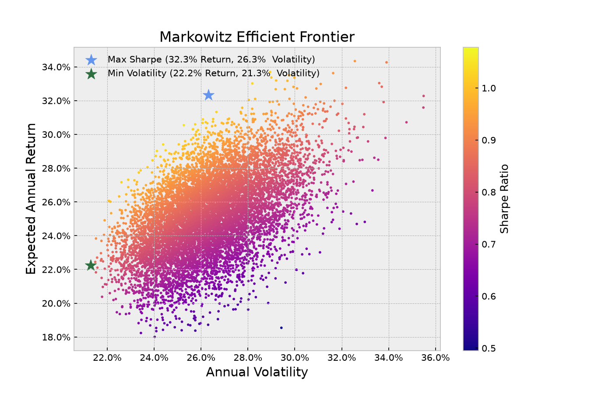

# Markowitz Efficient Frontier

Monte Carlo simulation of 10,000 random portfolio allocations in Python based on Modern Portfolio Theory (Markowitz).

## Overview
- Downloads historical daily prices from Yahoo Finance (`2020–present`) for 10 stocks across Tech, Finance, Healthcare, and Energy (`AAPL`, `MSFT`, `GOOGL`, `AMZN`, `NVDA`, `META`, `TSLA`, `JPM`, `LLY`, `XOM`)
- Pulls the current 13-week US Treasury Bill rate (`^IRX`) as the live risk-free rate
- Computes annualized log-returns, covariance matrix, portfolio volatility, and Sharpe Ratio for 10,000 random weight combinations
- Identifies the **Maximum Sharpe Ratio** portfolio and the **Minimum Volatility** portfolio

## Files
- `main.py` – data fetching, Monte Carlo simulation, and optimal portfolio weights
- `plots.py` – scatter plot of the Efficient Frontier

